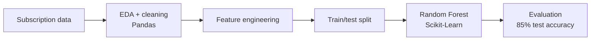

# Customer Churn Predictive Model

Supervised machine learning model (Random Forest) that predicts which subscribers are likely to cancel, reaching **85% accuracy** on held-out test data.

**Stack:** Python · Pandas · Scikit-Learn

## The problem
Losing subscribers is expensive, and retention teams cannot contact everyone. A model that flags at-risk customers lets them focus effort where it matters.

## Architecture



## Approach
- **EDA:** inspected distributions, missing values and churn drivers.
- **Feature engineering:** built features from raw subscription behavior.
- **Model:** Random Forest classifier evaluated on a held-out test set.

## Results
- **85% test accuracy** on the held-out set.

## Run it
```bash
git clone https://github.com/VasilenData/customer-churn-model.git
cd customer-churn-model
python -m venv .venv && source .venv/bin/activate
pip install -r requirements.txt
jupyter notebook notebooks/churn_model.ipynb
```

## Status
Notebook and data-prep code are being added to this repository.

---
Built by [Vasilen Kanchev](https://vasilendata.github.io) · [LinkedIn](https://www.linkedin.com/in/vasilen-kanchev-030878290/)
