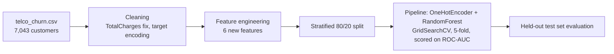
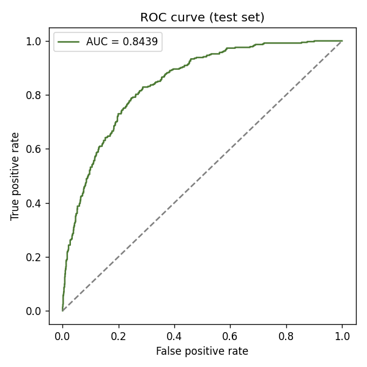
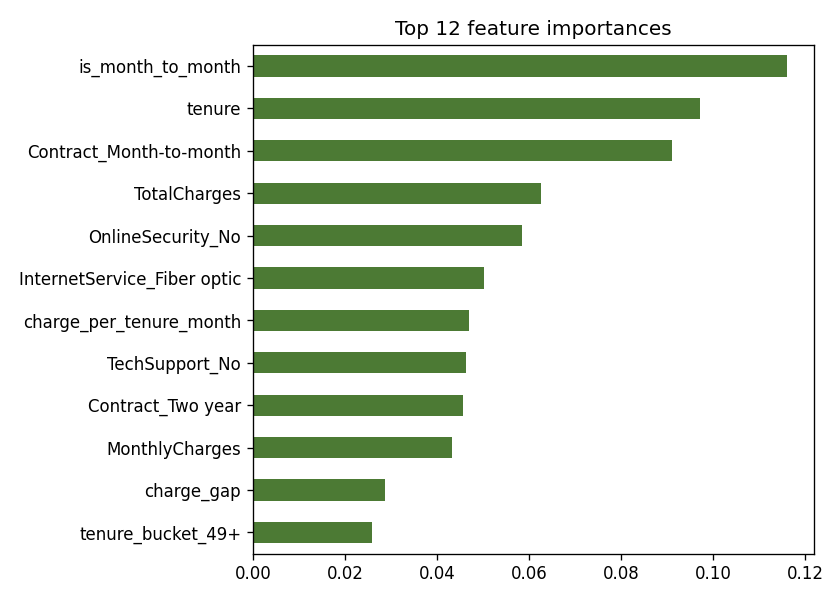

# Customer Churn Predictive Model

Random Forest classifier with feature engineering that predicts which telecom subscribers will cancel. Built on the public IBM Telco Customer Churn dataset (7,043 customers, 26.5% churn).

**Stack:** Python · Pandas · Scikit-Learn · Matplotlib

## The problem
A retention team cannot call every customer. The model ranks customers by churn risk so the team can focus on the ones most likely to leave.

## Architecture



## Results (held-out test set, 1,409 customers)

| Metric | Tuned model (class-weighted) | Always predict "stay" |
|---|---|---|
| Accuracy | **76.3%** | 73.5% |
| Recall on churners | **77.8%** | 0% |
| Precision on churners | 53.7% | n/a |
| F1 (churn class) | 0.635 | n/a |
| ROC-AUC | **0.844** | 0.5 |

- Cross-validated ROC-AUC on the training set: 0.848, so the test score is not a lucky split.
- **Why 76% accuracy, not higher:** the model is class-weighted to catch more churners. Without weighting, accuracy rises to about 80.2% but recall on churners falls to 51.9% (same AUC of about 0.84). For retention, missing churners is the costly error, so I chose recall. The accuracy-only baseline of 73.5% shows why accuracy alone is a weak yardstick on imbalanced data.
 

- Top drivers (see `outputs/feature_importance.png`): contract type, tenure, and monthly vs. total charges.

## Feature engineering
| Feature | Idea |
|---|---|
| `n_services` | count of services a customer has (stickiness) |
| `charge_per_tenure_month` | average amount actually paid per month |
| `charge_gap` | current monthly charge minus historical average (price increases) |
| `tenure_bucket` | non-linear tenure effect (0-6, 7-12, 13-24, 25-48, 49+ months) |
| `is_month_to_month` | no-commitment contract flag |
| `auto_pay` | automatic payment method flag |

## Run it
```bash
git clone https://github.com/VasilenData/customer-churn-model.git
cd customer-churn-model
pip install -r requirements.txt
pytest -q                 # data and feature checks
python src/train.py       # trains, prints metrics, writes outputs/metrics.json and charts (~30 s)
```

## Notes and limits
- Metrics come from one fixed split (`random_state=42`) plus 5-fold CV for tuning. Results vary by a point or two with a different seed.
- Dataset: [IBM telco-customer-churn-on-icp4d](https://github.com/IBM/telco-customer-churn-on-icp4d), a sample dataset, not real production data.
- Next steps: probability calibration, a cost-based threshold (cost of a retention offer vs. lost revenue), gradient boosting comparison, SHAP explanations.

---
Built by [Vasilen Kanchev](https://vasilendata.github.io) · [LinkedIn](https://www.linkedin.com/in/vasilenkanchev/)
