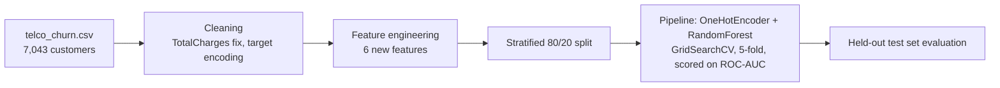
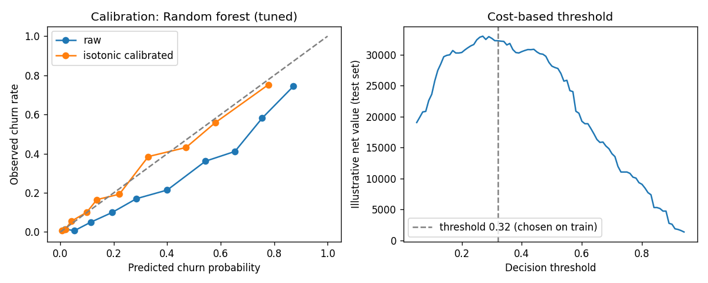

# Customer Churn Predictive Model

[](https://github.com/VasilenData/customer-churn-model/actions/workflows/ci.yml) [](LICENSE) 

Random Forest classifier with feature engineering that predicts which telecom subscribers will cancel. Built on the public IBM Telco Customer Churn dataset (7,043 customers, 26.5% churn).

**Stack:** Python · Pandas · Scikit-Learn · Matplotlib

**Headline:** ROC-AUC 0.84 and 78% recall on churners. A simple logistic regression scores the same AUC as the tuned forest (0.847 vs 0.848 in cross-validation), so the extra complexity buys little; the real lever is the decision threshold (see below).

## The problem
A retention team cannot call every customer. The model ranks customers by churn risk so the team can focus on the ones most likely to leave.

## Architecture



## Results (held-out test set, 1,409 customers)

| Metric | Tuned model (class-weighted) | Always predict "stay" |
|---|---|---|
| Accuracy | **76.3%** | 73.5% |
| Recall on churners | **77.8%** | 0% |
| Precision on churners | 53.7% | n/a |
| F1 (churn class) | 0.635 | n/a |
| ROC-AUC | **0.844** | 0.5 |

- Cross-validated ROC-AUC on the training set: 0.848, so the test score is not a lucky split.
- **Why 76% accuracy, not higher:** the model is class-weighted to catch more churners. Without weighting, accuracy rises to about 80.2% but recall on churners falls to 51.9% (same AUC of about 0.84). For retention, missing churners is the costly error, so I chose recall. The accuracy-only baseline of 73.5% shows why accuracy alone is a weak yardstick on imbalanced data.
 

- Top drivers (see `outputs/feature_importance.png`): contract type, tenure, and monthly vs. total charges.

## Model comparison, calibration and decision threshold
`python src/compare.py` compares three models on the same split, calibrates the chosen one and picks a threshold from a cost model. All numbers below are from `outputs/model_comparison.json`.

| Model | CV ROC-AUC (train, 5-fold) | Test ROC-AUC | Test recall | Test precision | Brier score |
|---|---|---|---|---|---|
| Logistic regression | 0.847 | 0.845 | 80.8% | 50.9% | 0.166 |
| Random forest (tuned) | **0.848** | 0.844 | 77.8% | 53.7% | 0.156 |
| Gradient boosting | 0.844 | 0.841 | 78.3% | 52.3% | 0.162 |

- **The three models are statistically close** (CV standard deviation is about 0.01). I kept the random forest because it had the best cross-validated score, chosen on the training data and not on the test set.
- **Calibration:** isotonic calibration lowers the Brier score from 0.156 to 0.136, so predicted probabilities can be read as real churn rates (left chart below).
- **Permutation importance on held-out data** (drop in AUC when a feature is shuffled): `Contract` 0.022, `tenure` 0.015, `InternetService` 0.012, `is_month_to_month` 0.011.



**Choosing the threshold with a cost model.** Business assumptions are illustrative and set at the top of `src/compare.py`: an offer costs 60, keeps 25% of the churners it reaches, and a saved customer is worth 12 months of their monthly charge. With those numbers, the threshold chosen on training data (0.32) gives a test-set net value of about 32,300, versus about 28,200 at the default 0.5 and about -2,900 when contacting everyone. Recall at 0.32 is 73% with 56% precision. Change the assumptions to your own business before using the threshold.

## Feature engineering
| Feature | Idea |
|---|---|
| `n_services` | count of services a customer has (stickiness) |
| `charge_per_tenure_month` | average amount actually paid per month |
| `charge_gap` | current monthly charge minus historical average (price increases) |
| `tenure_bucket` | non-linear tenure effect (0-6, 7-12, 13-24, 25-48, 49+ months) |
| `is_month_to_month` | no-commitment contract flag |
| `auto_pay` | automatic payment method flag |

## Run it
```bash
git clone https://github.com/VasilenData/customer-churn-model.git
cd customer-churn-model
pip install -r requirements.txt
pytest -q                 # data, feature and cost-function tests
python src/train.py       # trains, prints metrics, writes outputs/metrics.json and charts (~30 s)
python src/compare.py     # model comparison, calibration, cost-based threshold (~15 s)
```

## Notes and limits
- Metrics come from one fixed split (`random_state=42`) plus 5-fold CV for tuning. Results vary by a point or two with a different seed.
- Dataset: [IBM telco-customer-churn-on-icp4d](https://github.com/IBM/telco-customer-churn-on-icp4d), a sample dataset, not real production data.
- The cost model uses assumed, not measured, offer costs and success rates.
- Next steps: SHAP explanations per customer, a time-based split if dates were available, and an A/B test of the retention offer.

---
Built by [Vasilen Kanchev](https://vasilendata.github.io) · [LinkedIn](https://www.linkedin.com/in/vasilenkanchev/)
